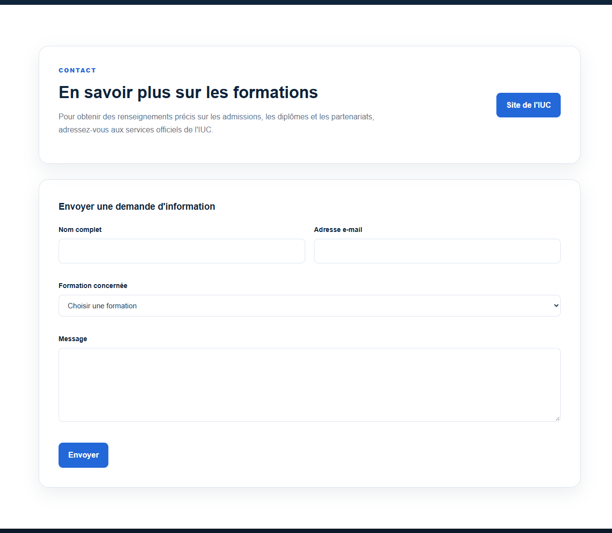
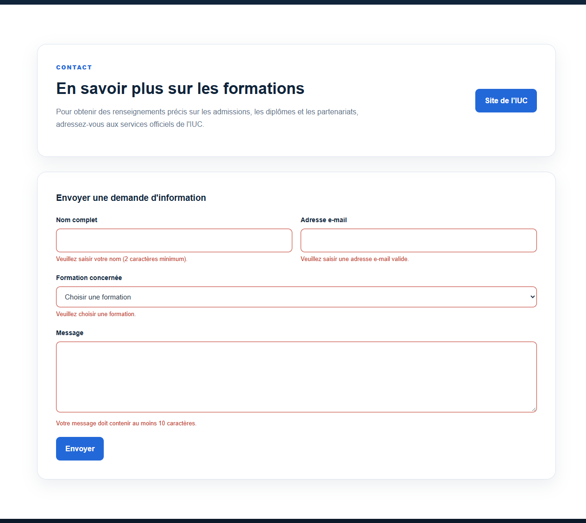
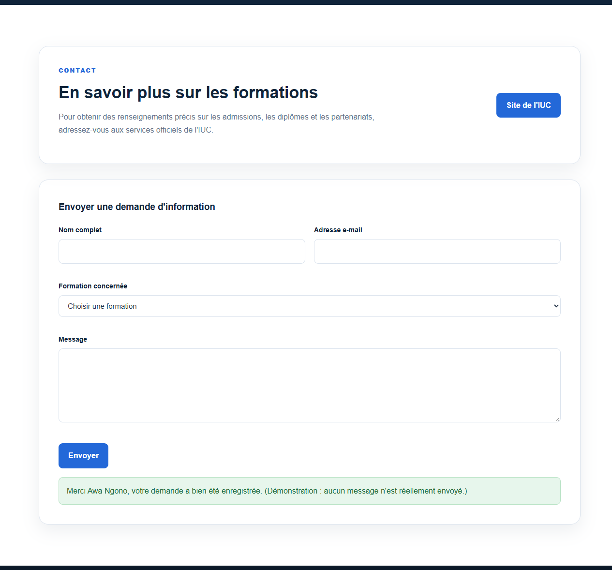
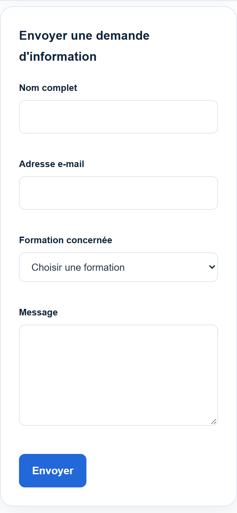
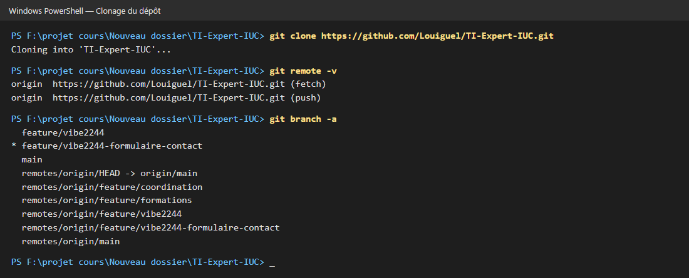
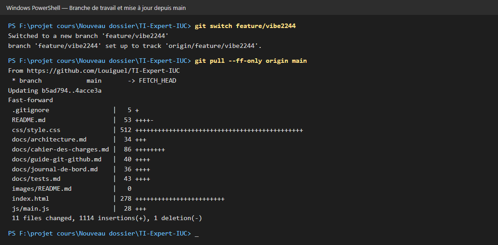
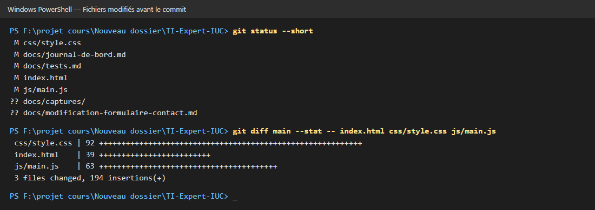
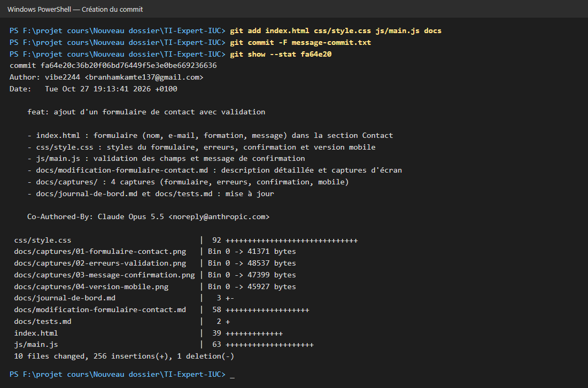
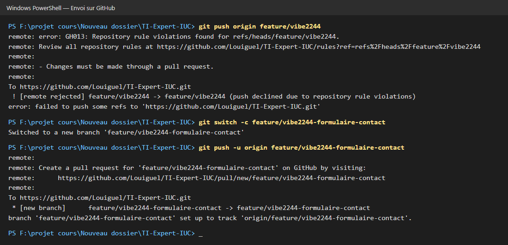
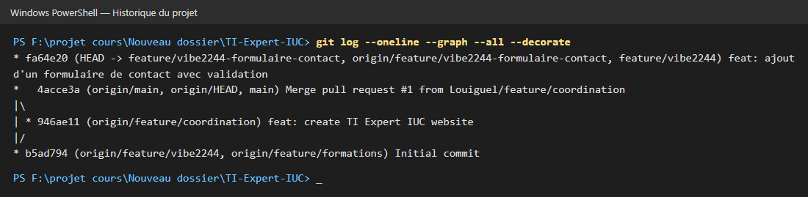

# Ajout d'un formulaire de contact

- Auteur : vibe2244
- Branche : feature/vibe2244
- Type : nouvelle fonctionnalité

## 1. Objectif

Permettre au visiteur d'envoyer une demande d'information sur les
formations directement depuis la section Contact du site.

## 2. Fichiers modifiés

| Fichier | Modification |
|---|---|
| index.html | Ajout du formulaire (nom, e-mail, formation, message) dans la section `#contact`. |
| css/style.css | Styles du formulaire, des messages d'erreur et du message de confirmation, adaptation mobile. |
| js/main.js | Validation des champs en JavaScript et affichage d'un message de confirmation. |

## 3. Fonctionnement

- Chaque champ est vérifié quand on le quitte et à l'envoi :
  - nom : 2 caractères minimum ;
  - e-mail : format valide ;
  - formation : choix obligatoire ;
  - message : 10 caractères minimum.
- Les champs invalides passent en rouge avec un message d'erreur.
- Si tout est valide, un message de confirmation s'affiche et le formulaire est vidé.
- Le site étant statique, aucun message n'est réellement envoyé
  (démonstration côté navigateur uniquement).

## 4. Captures d'écran

### Formulaire affiché

### Erreurs de validation (envoi d'un formulaire vide)

### Message de confirmation (formulaire valide)

### Version mobile (390 px)

## 5. Tests effectués

| Test | Résultat |
|---|---|
| Affichage du formulaire (bureau) | Réussi |
| Envoi d'un formulaire vide : erreurs affichées | Réussi |
| Envoi d'un formulaire valide : confirmation affichée | Réussi |
| Affichage mobile sans défilement horizontal | Réussi |
| Console JavaScript sans erreur | Réussi |

## 6. Commandes Git utilisées

### Clonage du dépôt et branches disponibles

### Passage sur ma branche et mise à jour depuis main

### Fichiers modifiés avant le commit

### Création du commit

### Envoi sur GitHub

Le premier envoi sur `feature/vibe2244` a été refusé : une règle du dépôt
impose de passer par une Pull Request. Le travail a donc été envoyé sur une
nouvelle branche `feature/vibe2244-formulaire-contact`, puis proposé en
Pull Request.

### Historique du projet

